<div align="center">

# catet

*Catet dulu, aman kemudian.*

A calm, pastel personal finance tracker for Android, built with Jetpack Compose and Room. Works offline; the internet is only used to refresh stock prices when you tap refresh.

[](https://developer.android.com/)
[](https://kotlinlang.org/)
[](https://developer.android.com/jetpack/compose)
[](https://developer.android.com/about/versions/oreo)
[](LICENSE)

<br/>

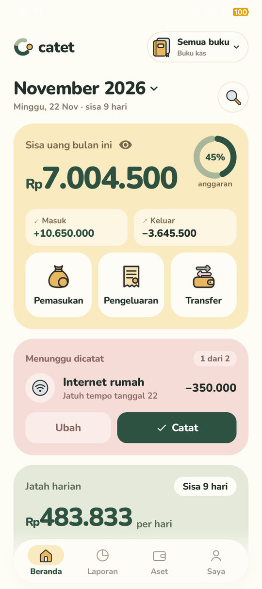&nbsp;
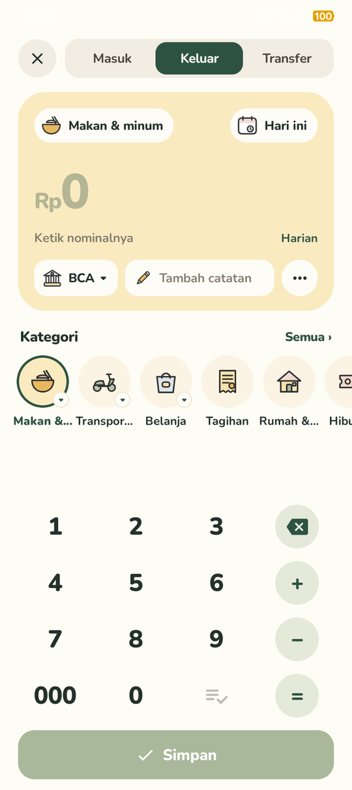&nbsp;
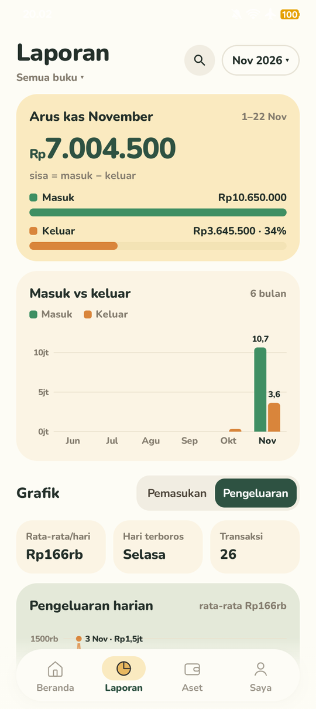

</div>

---

## Overview

catet is a daily expense tracker for Indonesian users (Rupiah, Bahasa Indonesia). It answers three questions at a glance:

1. How much money is left this month?
2. How much can I safely spend today?
3. Where did my money go?

The visual style follows the "R89" reference: warm cream background, deep green accents, large pastel cards (yellow, pink, sage) and two-tone sticker icons. The flows (ledgers, subcategories, reimburse, bookmarks, budgets, recurring bills) follow the Meow Expense app.

## Screenshots

| Beranda | Jatah harian | Riwayat |
| :---: | :---: | :---: |
|  | 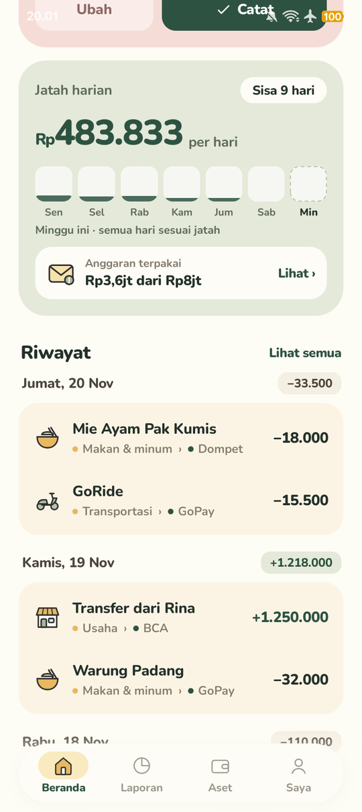 | 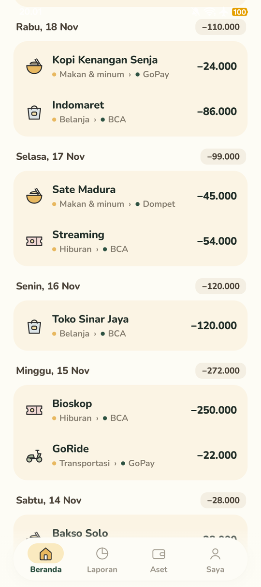 |
| Remaining balance, budget ring, quick actions, pending bill | Daily allowance with a 7-day strip and budget usage | Records grouped by day with daily totals |

| Tambah transaksi | Pilih tanggal | Pilih jam |
| :---: | :---: | :---: |
|  | 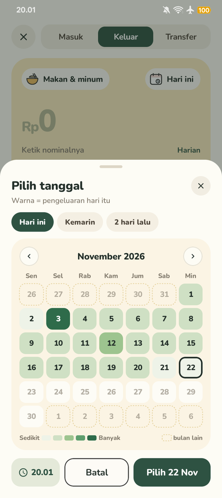 | 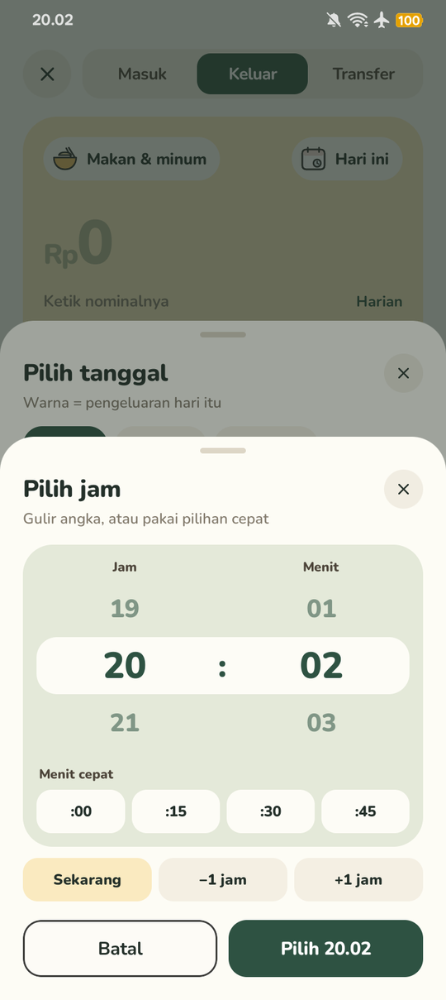 |
| Calculator keypad and scrollable category row | Calendar tinted by daily spending; other months dashed | Hour and minute scroll wheels with quick chips |

| Pilih periode | Laporan | Grafik |
| :---: | :---: | :---: |
| 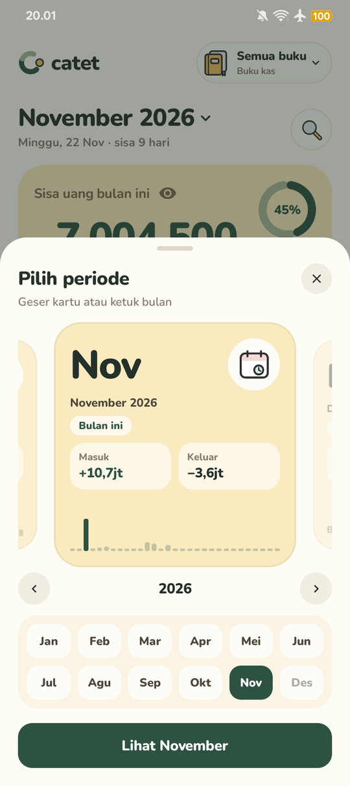 |  | 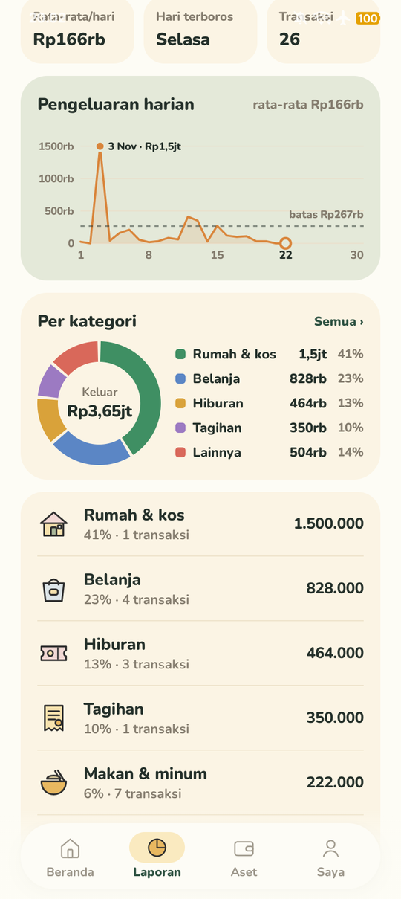 |
| Swipeable month cards with income, spending and daily bars | Cash flow and 6-month income vs spending | Daily spending line, category donut and list |

| Aset | Saya |
| :---: | :---: |
| 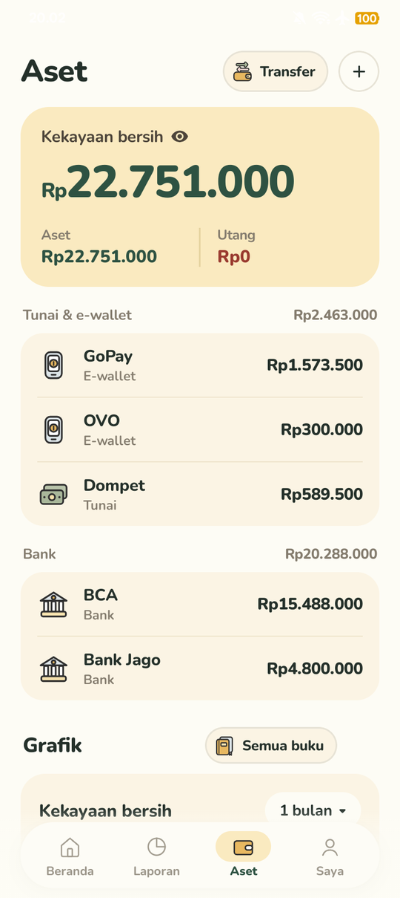 | 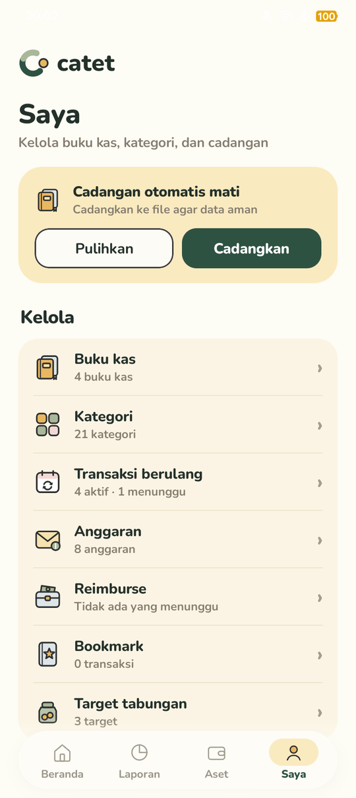 |
| Net worth, accounts grouped by type | Backup, ledgers, categories, budgets and settings |

## Features

**Budget and daily allowance**
- Daily allowance (`safePerDay`) from the remaining monthly budget and days left.
- Budget ring on the home card, per-category budgets with over-budget warnings.
- 7-day strip comparing each day's spending with the allowance.

**Fast entry**
- Calculator keypad (`15000 + 4000`), subcategories, transfers with fees.
- Reimburse flag, bookmarks, multiple ledgers, recurring bills recorded with one tap.
- Date picker tinted by spending, scroll-wheel time picker.

**Reports**
- Cash flow card, 6-month income vs spending bars.
- Daily spending line with budget limit, category donut, spending heatmap.

**Budget rollover**
- Carry a budget's unspent amount into the next period, and optionally its overspending too.

**Investments**
- Stocks (IDX), gold, bonds and mutual funds, kept apart from cash on the Aset screen and hideable with one switch.
- Every buy is recorded; the weighted average price, gain and dividends are calculated automatically.
- Delayed IDX prices from Yahoo Finance, fetched only when you tap refresh. Other kinds use a manual price.

**Debts and splitting bills**
- Track money lent (piutang) and borrowed (utang) per person, with optional monthly installments and overdue status.
- Send a polite reminder through WhatsApp with one tap (you press send).
- Patungan: split any spending record between friends; your share stays as spending, theirs become receivables.

**Monthly PDF report**
- Summary vs last month, automatic insights, daily chart, budgets, income sources, account balances, net worth and the transaction list, saved or shared as an A4 PDF.

**Home screen widgets**
- Seven widgets that follow the phone's light/dark mode: Catat cepat (4×1), Anggaran & catat (4×2), Sisa bulan ini, Jatah harian and Streak (2×2), Catat and Menunggu dicatat (2×1).

**Automatic detection from notifications**
- Reads payment and transfer notifications from supported bank and e-wallet apps (BCA, Mandiri, BRI, BNI, GoPay, OVO, DANA, ShopeePay and more) into waiting records with a guessed category and account. Save, review or skip from Beranda or the notification itself. Runs entirely on the device; OTPs and promos are ignored and notification text is not stored.

**Dark mode**
- A warm "dusk" dark theme with night versions of the pastel cards. Choose light, dark or follow the phone, and optionally switch to dark automatically from 18.00 to 06.00.

**Streaks and badges**
- A small flame on Beranda counts days in a row with at least one record. The Pencapaian screen shows the month at a glance and nine badges earned from everyday habits, with no mascot.

**Zakat and sedekah**
- Zakat maal against the 85 g gold nisab (gold price fetched online), monthly zakat on income, and a sedekah target with history.

**Assets and goals**
- Cash and e-wallets, banks, credit cards and debts, with net worth.
- Savings goals with progress.

**Privacy and data**
- No analytics or tracking. The app only goes online when you refresh prices or open Zakat: it sends a stock ticker (e.g. BBCA.JK) to Yahoo Finance and reads the public gold (Galeri24) and bond (IBPA) price pages. Notification detection runs entirely on the phone.
- PIN lock, automatic backups through the Storage Access Framework, JSON and CSV export/import.

## Design system


| Token | Hex | Used for |
| :--- | :---: | :--- |
| `K.Bg` / `K.Sheet` | `#FDFCF5` | Screen and sheet background |
| `K.Card` | `#FBF4E4` | Cream list cards |
| `K.Field` | `#F4EFE3` | Inputs, chips, keypad |
| `K.Yellow` | `#FAEAC0` | Main cards (balance, cash flow) |
| `K.Pink` | `#F5DCD7` | Pending actions (bills due) |
| `K.SageCard` | `#E4E9D9` | Daily allowance and budget |
| `K.Green` | `#2E5242` | Primary buttons, selection, balances |
| `K.Ink` | `#24302A` | Titles and body text |
| `K.Muted` | `#847C6E` | Labels and captions |
| `K.Danger` | `#9A3B30` | Over budget, debts, delete |

- Font: Nunito (variable). Labels are light and warm grey; amounts are bold green.
- Icons: hand-drawn two-tone vector icons (`CatIcon`) on a 48dp grid.
- The full rules for layout and components are in [AGENTS.md](AGENTS.md).

## Project structure

```
id.kantong.app
├── MainActivity.kt          Single activity, density scaled to a 390dp layout
├── data/
│   ├── Model.kt             Room entities, DAOs, migrations
│   ├── AppViewModel.kt      App state and calculations
│   ├── Prefs.kt             Preferences as Compose state
│   ├── AutoBackup.kt        SAF backup and restore
│   ├── Format.kt            Rupiah and date formatting
│   └── ViewPeriod.kt        Month shared by Beranda and Laporan
└── ui/
    ├── KantongApp.kt        Navigation and floating bottom bar
    ├── theme/Theme.kt       Design tokens (K) and typography
    ├── components/          Cards, sheets, charts, icons, pickers
    └── screens/             Beranda, Tambah, Laporan, Aset, Saya and sub-screens
```

The application ID stays `id.kantong.app` so existing installs keep their data.

## Build

Requirements: JDK 17, Android SDK 35, a device or emulator on Android 8.0 or newer.

```bash
git clone https://github.com/halimxn/catet.git
cd catet
echo "sdk.dir=/path/to/android/sdk" > local.properties
./gradlew assembleRelease
adb install -r app/build/outputs/apk/release/app-release.apk
```

## Roadmap

- [ ] Receipt photos with on-device OCR
- [x] Transaction detection from notifications (on-device)
- [x] Logging streaks and badges
- [x] Dark mode

## License

MIT. See [LICENSE](LICENSE).

Made by [Abdul Halim](https://github.com/halimxn).
