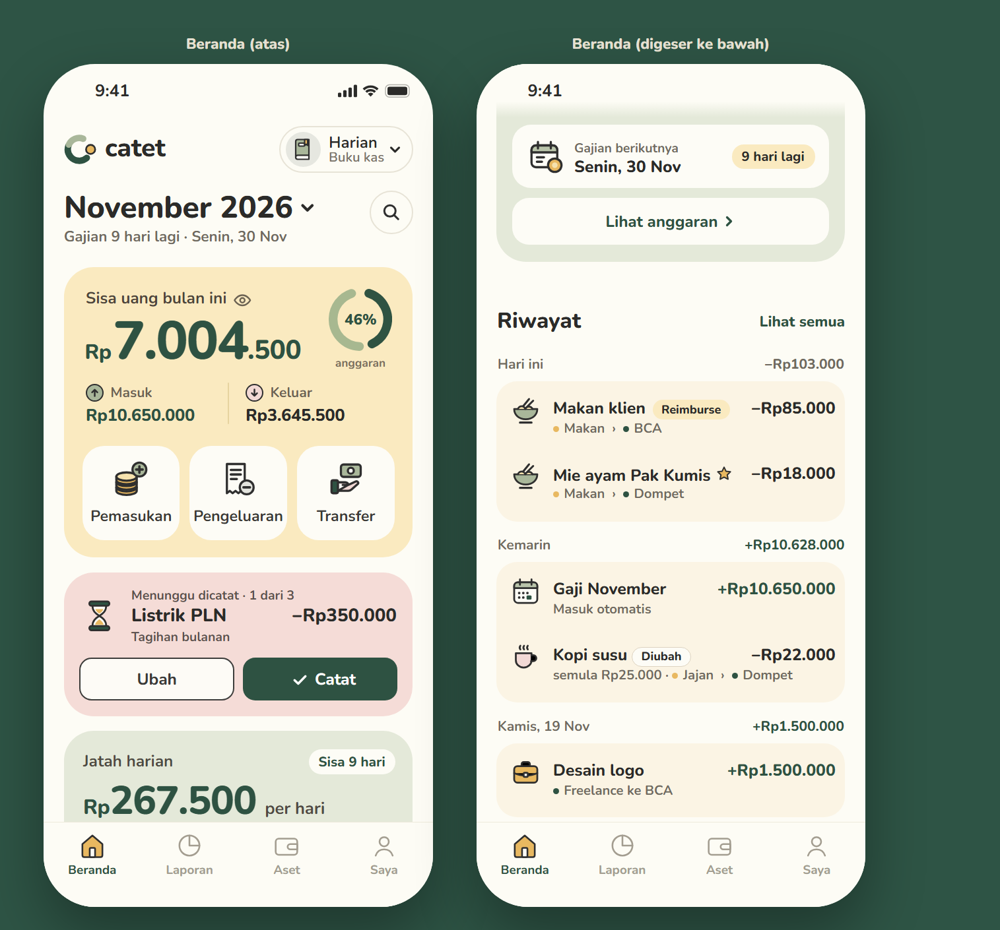
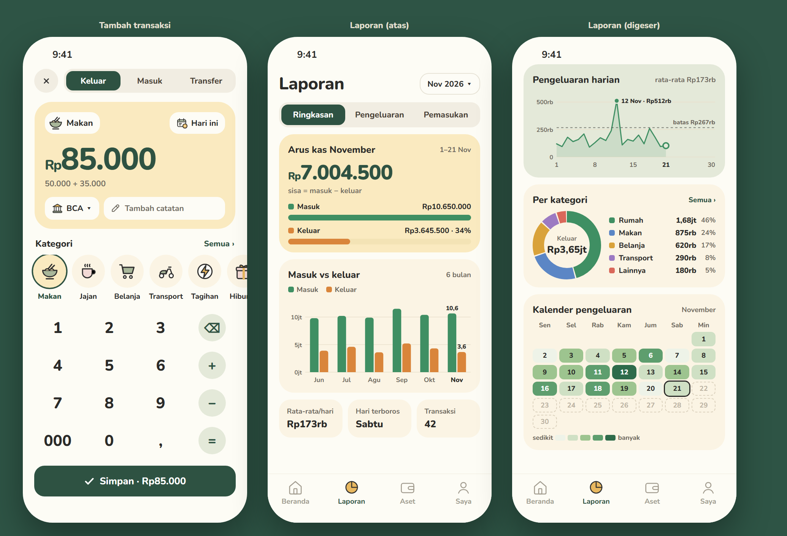
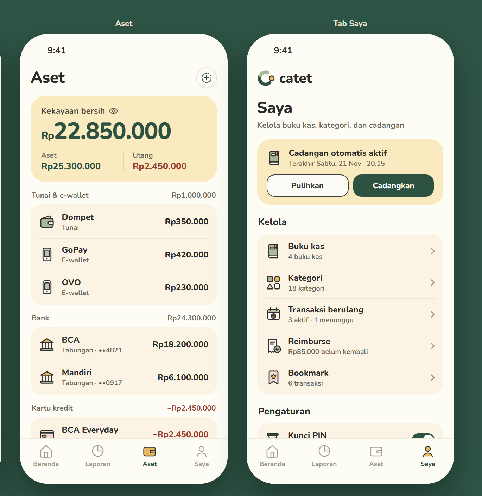
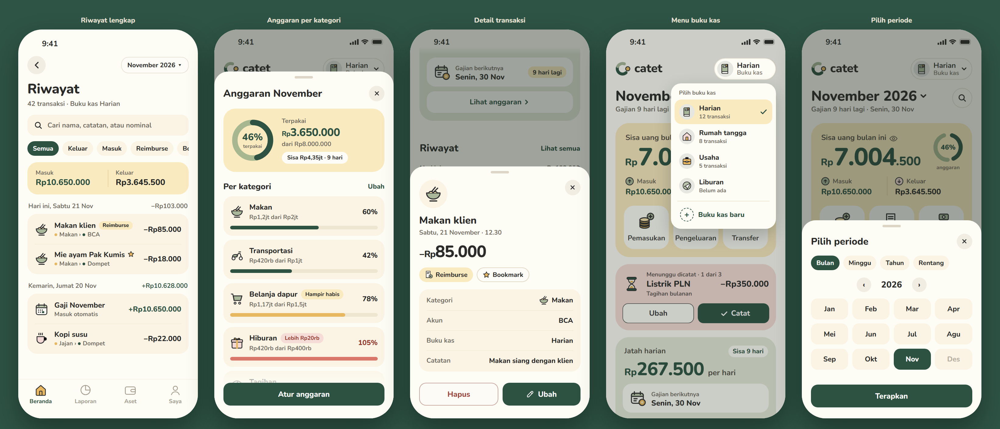
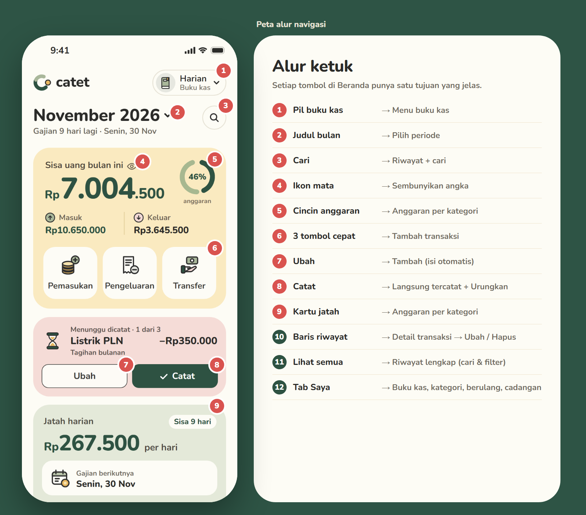
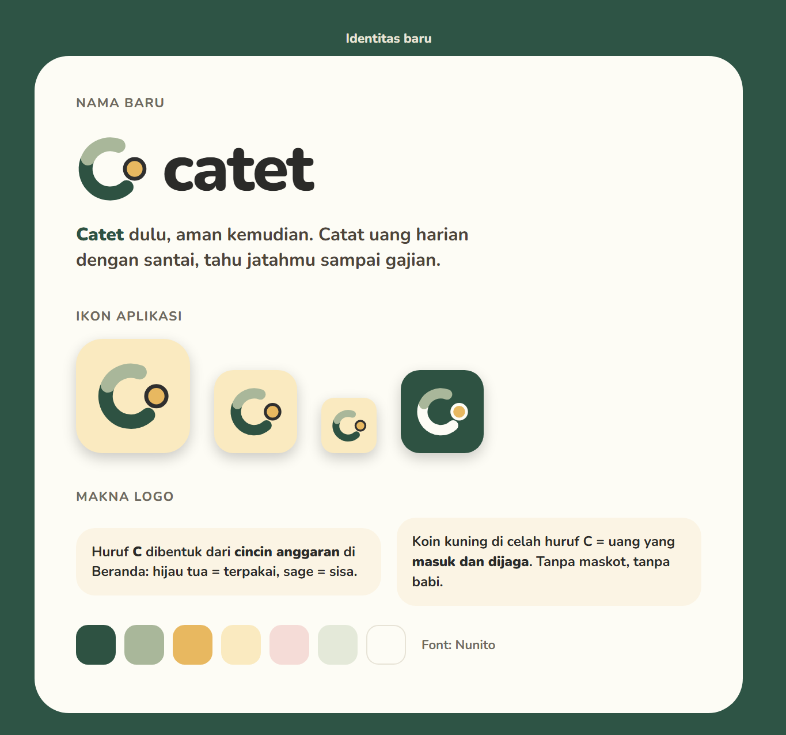

<div align="center">

# catet

### *Catet dulu, aman kemudian.*

A serene, pastel-toned personal finance and cash flow companion for Android.<br/>
Crafted with modern **Jetpack Compose**, **Material 3**, and **Offline-First Room Architecture**.

[](https://developer.android.com/)
[](https://kotlinlang.org/)
[](https://developer.android.com/jetpack/compose)
[](https://developer.android.com/training/data-storage/room)
[-informational.svg?style=flat-square)](https://android-arsenal.com/api?level=26)
[-success.svg?style=flat-square)](https://developer.android.com/about/versions/15)
[](https://github.com/halimxn/catet)
[](LICENSE)

<br/>



</div>

---

## 📖 Overview

**catet** is an intimate, delightfully calm daily expense tracker specifically designed for everyday financial clarity. Unlike bloated accounting software filled with overwhelming tables and complex charts, **catet** focuses on what truly matters to you:

1. **How much money is left this month?**
2. **What is my safe daily spending allowance today?**
3. **Where is my cash flow moving?**

Built following the soothing **"R89" pastel design philosophy** (warm cream backgrounds, soft pastel cards, and forest green accents), **catet** transforms tedious bookkeeping into a gentle, stress-free daily ritual.

---

## ✨ Visual Showcase

| Home & Daily Allowance | Transaction Entry & Analytics | Net Worth & Assets |
| :---: | :---: | :---: |
|  |  |  |
| *Real-time remaining balance, daily allowance pill, and quick entry shortcuts.* | *Fast expression-enabled keypad, subcategories, and 6-month cashflow trends.* | *Unified asset distribution, debt monitoring, and automated backup vault.* |

### Supporting Interfaces & Navigation Architecture

<div align="center">
  
  <p><em>Comprehensive sub-screens: Date period pickers, category budget sheets, transaction timeline, and multi-ledger managers.</em></p>
</div>

<div align="center">
  
  <p><em>Zero-friction navigation topology connecting Beranda (Home), Laporan (Reports), Aset (Assets), and Saya (Settings).</em></p>
</div>

---

## 🌟 Key Features

### 🎯 Intelligent Daily Allowance & Budgeting
- **Safe Daily Spend (`safePerDay`)**: Dynamically computes how much you can spend per day based on remaining monthly budget and days left.
- **Visual Budget Progress Ring**: Instantly see your spending percentage without crunching mental math.
- **Category-Level Budgets**: Set spending envelopes for F&B, Transport, Leisure, and essentials with over-budget alerts.

### ⚡ Rapid-Fire Transaction Input
- **Built-in Calculator Keypad**: Add items with inline calculations (`15000 + 4000 = 19000`) directly on the numeric pad.
- **Subcategories & Fast Tagging**: Select and expand categories in a single tap without endless page transitions.
- **Account Transfer with Fee Support**: Record bank transfers, e-wallet top-ups, and admin fees accurately in one flow.
- **Reimbursement & Bookmarks**: Flag work-related expenses for reimbursement tracking and bookmark recurring transactions.

### 📊 Insightful, Calm Analytics
- **6-Month Cash Flow Bar Comparison**: Tap across months to see trends in income versus expenses.
- **Interactive Expense Donut**: Visual breakdown by category with clean percentage distribution.
- **Daily Spending Heatmap**: Calendar-style heat levels reflecting transaction intensity.
- **Key Metrics Highlight**: Daily spending average, peak spending days, and total monthly transaction counts.

### 💼 Net Worth & Multi-Ledger Support
- **Asset Grouping**: Track Cash & E-wallets, Bank Accounts, Investment Accounts, and Credit Cards/Paylater.
- **Separate Ledgers**: Keep personal, household, side-hustle, or vacation books completely segregated.
- **Financial Goals (Target Tabungan)**: Set targets for emergency funds or gadget upgrades with visual progress.

### 🔒 Privacy, Security & Data Ownership
- **100% Offline-First**: Your financial data stays strictly on your device. Zero analytics trackers, zero external telemetry.
- **App Lock**: Protect your financial privacy with a 4-digit PIN lock.
- **Automatic SAF Backups**: Configurable scheduled backups directly to local storage or cloud folders via Android's Storage Access Framework (SAF).
- **Import / Export**: Full JSON and CSV data portability anytime.

---

## 🎨 Design System ("R89")

The visual soul of `catet` adheres to the **R89 design language**: gentle on the eyes, warm, and distinctly non-clinical.

<div align="center">
  
</div>

### Color Tokens (`K`)
| Token | Hex Code | Purpose |
| :--- | :---: | :--- |
| **`K.Bg` / `Sheet`** | `#FDFCF5` | Serene warm cream app background |
| **`K.Card`** | `#FBF4E4` | Soft cream list cards (history, settings) |
| **`K.Field`** | `#F4EFE3` | Neutral input surfaces, pill chips, keypad cells |
| **`K.Yellow`** | `#FAEAC0` | Primary hero cards (monthly balance, cash flow) |
| **`K.Pink`** | `#F5DCD7` | Action-required cards (due recurring bills) |
| **`K.SageCard`** | `#E4E9D9` | Daily allowance & budget highlights |
| **`K.Green`** | `#2E5242` | Primary buttons, active tabs, positive balances |
| **`K.Danger`** | `#9A3B30` | Over-budget warnings, debts, deletion actions |
| **`K.Ink`** | `#2B2B29` | High-contrast typography and negative values |

### Typography & Iconography
- **Typography**: Variable **Nunito** font with custom weight mapping (Medium 680, SemiBold 720, Bold 800, ExtraBold 850).
- **Iconography**: Custom hand-crafted two-tone vector icons (`CatIcon`) rendered via canvas routines on a 48dp grid, mapped with warm golden, sage, and cream tones.

---

## 🏗️ Architecture & Tech Stack

```
id.kantong.app
├── MainActivity.kt                # Single activity, edge-to-edge Compose host
├── data/
│   ├── Model.kt                   # Room database entities (Txn, Account, Category, Ledger, Budget)
│   ├── AppViewModel.kt            # MVVM state container & calculation engine
│   ├── Prefs.kt                   # Compose-reactive persistent user preferences
│   ├── AutoBackup.kt              # SAF-based JSON backup & restore manager
│   ├── Format.kt                  # Indonesian currency & date formatting utilities
│   ├── Reminder.kt                # Daily notification reminder alarms
│   ├── Seed.kt                    # Sensible initial defaults for new users
│   └── ViewPeriod.kt              # Shared active period state
├── ui/
│   ├── KantongApp.kt              # Root navigation & floating capsule bottom bar
│   ├── theme/
│   │   └── Theme.kt               # Design tokens (K), Nunito typography, shape styles
│   ├── components/
│   │   ├── Catet.kt               # Core cards, chips, buttons, and currency typography
│   │   ├── Meow.kt                # Keypad, toggles, sheets, and overlay elements
│   │   ├── Records.kt             # Transaction list rows and daily timeline
│   │   ├── Illus.kt               # Two-tone vector icon engine (CatIcon)
│   │   └── ReportCharts.kt        # Interactive bars, lines, and heatmaps
│   └── screens/
│       ├── HomeScreen.kt          # Main dashboard (balance, allowance, timeline)
│       ├── AddTransactionScreen.kt# Express calculator entry
│       ├── ReportsScreen.kt       # Comprehensive analytics & cash flow
│       ├── AssetsScreen.kt        # Net worth & account management
│       ├── SettingsScreen.kt      # Backup, security, and preferences
│       ├── OnboardingScreen.kt    # 4-step introductory setup
│       └── ...                    # Dedicated management screens
```

### Stack Highlights
- **Kotlin 2.0.21** with native Compose compiler
- **Jetpack Compose (BOM 2024.12.01)** with Material 3 integration
- **AndroidX Room 2.6.1** with SQLite migration management
- **AndroidX Navigation Compose 2.8.5**
- **R8 Full Mode & Proguard optimization** with debug signing for effortless local testing
- **Dynamic Density Scaling**: Automatically calibrated to ensure a crisp, pixel-perfect 390dp viewport layout across diverse device screens.

---

## 🚀 Getting Started

### Prerequisites
- **JDK 17** (Temurin, Zulu, or Android Studio bundled OpenJDK)
- **Android SDK** with Platform `android-35` and Build Tools installed
- **Android Device / Emulator** running Android 8.0 (API 26) or higher

### Build & Run from Source

1. **Clone the repository:**
   ```bash
   git clone https://github.com/halimxn/catet.git
   cd catet
   ```

2. **Configure your Android SDK path:**
   Create a `local.properties` file in the root directory:
   ```properties
   sdk.dir=/path/to/your/android/sdk
   ```

3. **Compile Kotlin sources:**
   ```bash
   ./gradlew compileReleaseKotlin
   ```

4. **Assemble the Release APK:**
   ```bash
   ./gradlew assembleRelease
   ```
   The optimized APK will be generated at:
   ```
   app/build/outputs/apk/release/app-release.apk
   ```

5. **Install on device via ADB:**
   ```bash
   adb install -r app/build/outputs/apk/release/app-release.apk
   ```

---

## 🗺️ Roadmap & Upcoming Milestones

- [ ] **Budget Rollover Engine**: Automatically roll unspent allowances into next month's envelope.
- [ ] **Debt & Arisan Tracking (Utang-Piutang)**: Dedicated debt ledger with repayment schedules.
- [ ] **Zakat & Sedekah Calculator**: Integrated wealth and charity obligation calculation from net assets.
- [ ] **Receipt Snap & On-Device OCR**: Capture receipts with ML Kit on-device text parsing.
- [ ] **Homescreen Glance Widgets**: Quick glance at remaining balance and daily allowance from your launcher.
- [ ] **Monthly PDF Statement Export**: Clean, printable summary reports for archiving.
- [ ] **Automatic Bank Notification Parsing**: Optional local notification listener for instant logging.
- [ ] **Streak & Habit Badges**: Subtle, mascot-free motivation for consistent daily logging.
- [ ] **Dedicated Night Mode**: Custom dark palette tokens respecting the calm aesthetic.

---

## 📄 License & Integrity

This project is licensed under the **MIT License** — see the [LICENSE](LICENSE) file for details.

Developed with ❤️ by **[Abdul Halim](https://github.com/halimxn)**.  
*Feedback and contributions are always welcome!*
